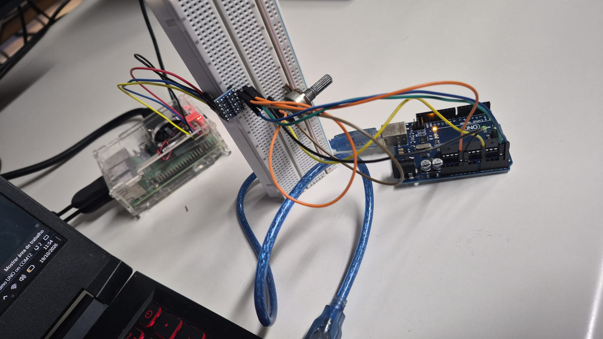

# SEL0337 — Projetos em Sistemas Embarcados

## Prática 4

**Autores:**
- Felipe Assis Bernardes Falvo — Nº USP: 15004433
- Kayke Malaquias Gregorio — Nº USP: 15651561

---

# 1. Introdução

Essa prática tem como ideia entender os protocolos de comunicação utilizados em sistemas embarcados.

O projeto utiliza uma Raspberry Pi que executa programas em Python, e um Arduino Uno, que executa programas e realiza operações como leitura de sinais e controle.

A atividade é dividida em três checkpoints:

- **Checkpoint 1: Comunicação I2C:** comunicação entre Raspberry Pi e Arduino para controlar o LED do microcontrolador.
- **Checkpoint 2: Aquisição analógica:** leitura de um potenciômetro pelo Arduino e transmissão do valor para a Raspberry Pi.
- **Checkpoint 3: RFID e SPI:** desenvolvimento de um sistema de controle de acesso utilizando um leitor RFID.

---

# 2. Checkpoint 1

## 2.1. Objetivo

Estabelecer uma comunicação serial entre o Raspberry Pi e o Arduino Uno utilizando a comunicação I2C.

A Raspberry Pi envia comandos pelo terminal, e o Arduino interpreta os valores recebidos para controlar o LED interno da placa. Dessa forma, o funcionamento da comunicação pode ser verificado tanto pelo LED, quanto pelo monitor do Arduino.

## 2.2. Funcionamento

A comunicação é dividida entre duas plataformas:

- **Raspberry Pi:** funciona como controlador, iniciando a comunicação e enviando os comandos utilizando a biblioteca `SMBus`.
- **Arduino Uno:** funciona como dispositivo controlado, recebendo os comandos pela biblioteca `Wire`, interpretando os valores e alterando o estado do LED interno.

O endereço I2C configurado no Arduino é `0x08`.

O funcionamento é:

* **Digitar `1`:** O Arduino acende o LED interno.
* **Digitar `0`:** O Arduino apaga o LED interno.
* **Digitar qualquer outro valor:** O programa é encerrado.

## 2.3. Protocolo I2C

O I2C é um protocolo de comunicação serial síncrona que utiliza duas ideias:

- **SDA (Data):** transmissão dos dados.
- **SCL (Clock):** clock utilizado para sincronizar.

## 2.4. Hardware

Como a Raspberry Pi utiliza níveis lógicos de 3,3 V e o Arduino Uno utiliza 5 V, foi utilizado um conversor de nível lógico para adaptar os sinais do barramento.

- **Alimentação de baixa tensão:** Conecta o Pino 1 da Raspberry Pi (3,3 V) ao pino **LV** do conversor.
- **Alimentação de alta tensão:** Conecta o pino 5V do Arduino Uno ao pino **HV** do conversor.
- **Referência:** Conecta o GND da Raspberry Pi e o GND do Arduino ao pino **GND** comum do conversor.
- **Barramento SDA:** Conecta a GPIO 2 da Raspberry Pi ao pino **LV3** e o pino A4 do Arduino ao pino **HV3**.
- **Barramento SCL:** Conecta a GPIO 3 da Raspberry Pi ao pino **LV4** e o pino A5 do Arduino ao pino **HV4**.


## 2.5. Arquivos do checkpoint

- [`arduino.ino`](Pratica4_checkpoint_1/arduino.ino): código do Arduino, responsável por configurar o endereço I2C, receber os comandos e controlar o LED.
- [`codigo_python.py`](Pratica4_checkpoint_1/codigo_python.py): código Python executado na Raspberry Pi, responsável por ler os comandos do usuário e enviar para o Arduino.
- [`hardware.jpeg`](Pratica4_checkpoint_1/hardware.jpeg): foto da montagem.
- [`video_prova.mp4`](Pratica4_checkpoint_1/video_prova.mp4): vídeo de demonstração do funcionamento.

## 2.6. Configuração e execução

Primeiramente, é necessário habilitar a interface I2C na Raspberry Pi:

```bash
sudo raspi-config
```

No menu, acessar:

`Interface Options → I2C → Enable`

Em seguida, verificar se o Arduino está sendo detectado no barramento:

```bash
sudo i2cdetect -y 1
```

O dispositivo deverá aparecer no endereço `0x08`.

Após gravar o programa no Arduino e conectar a montagem, abrir o monitor serial. No terminal da Raspberry Pi, execute o código:

```bash
python3 codigo_python.py
```

Os comandos `1` e `0` devem acender e apagar o LED, e qualquer outro valor desligar o programa.

## 2.7. Demonstração

**Montagem física:**


**Vídeo de demonstração:** [Assistir ao vídeo do Checkpoint 1](Pratica4_checkpoint_1/video_prova.mp4).

---

# 3. Checkpoint 2

## 3.1. Objetivo

Nesse segundo checkpoint, a ideia é obter informação por meio da leitura analógica de um potenciômetro.

Assim, o Arduino realiza a leitura do sinal, organiza o valor e envia os dados pelo I2C. A Raspberry Pi recebe os bytes e organiza o valor.

## 3.2. Aquisição

O potenciômetro é ligado a uma entrada analógica do Arduino Uno. Seu terminal é conectado ao pino `A0`, enquanto os outros terminais são conectados a alimentação e ao GND.

Ao girar o potenciômetro, a tensão aplicada à entrada analógica varia entre 0 e 5 V. O conversor analógico-digital de 10 bits do Arduino transforma essa tensão em um valor entre 0 e 1023.

* **0 V**: Leitura digital 0
* **2,5 V**: Leitura digital 512, aproximadamente
* **5 V**: Leitura digital 1023


## 3.3. Transmissão de dados

O barramento I2C transmite dados em unidades de 8 bits, enquanto a leitura do ADC do Arduino possui 10 bits.

Por isso, um único byte não é suficiente para representar todos os valores do potenciômetro, por esse motivo que o valor é dividido em dois bytes:

- **Byte alto:** bits mais significativos
- **Byte baixo:** bits menos significativos

No Arduino, as funções `highByte()` e `lowByte()` separam essas partes.

```cpp
byte dados[2];

dados[0] =highByte(valor_potenciometro);
dados[1] =lowByte(valor_potenciometro);

Wire.write(dados, 2);
```

O Arduino envia os dois bytes. Na Raspberry Pi, os bytes recebidos são unidos multiplicando o byte mais significativo por 256 (deslocando 8 posições para a esquerda) e somando com o byte menos significativo, reconstruindo o valor de 10 bits enviado pelo Arduino.

```python
byte_alto = dados[0]
byte_baixo = dados[1]

valor_final = (byte_alto * 256)+byte_baixo
```


## 3.4. Funcionamento

### Programa do Arduino

O arquivo `codigo_arduino.ino` utiliza a biblioteca `Wire` para configurar o dispositivo no endereço `0x08`.

A função `Wire.onRequest()` registra a função que será executada quando a Raspberry Pi solicitar os dados. Nessa função, o Arduino:

1. Le o valor analógico do pino `A0` por meio de `analogRead()`
2. Separa o valor em dois bytes utilizando `highByte()` e `lowByte()`.
3. Envia os bytes com `Wire.write()`.
4. Mostra o valor no Serial.

### Programa da Raspberry Pi

O arquivo `codigo_python.py` utiliza a biblioteca `SMBus` para acessar o barramento.

O programa solicita os dados ao Arduino, separa os bytes recebidos e organiza o valor. O resultado é exibido no terminal da Raspberry Pi para comparar com o valor mostrado no serial do Arduino.

## 3.5. Arquivos do checkpoint

- [`codigo_arduino.ino`](Pratica4_checkpoint_2/codigo_arduino.ino): realiza a leitura do potenciômetro, separa o valor em dois bytes e transmite os dados por I2C.
- [`codigo_python.py`](Pratica4_checkpoint_2/codigo_python.py): solicita os dados, reconstrói o valor de 10 bits e apresenta o resultado no terminal.
- [`hardware.jpeg`](Pratica4_checkpoint_2/hardware.jpeg): fotografia da montagem física.
- [`video_prova.mp4`](Pratica4_checkpoint_2/video_prova.mp4): vídeo de demonstração.

## 3.6. Validação

Com o Arduino programado e conectado a Raspberry, execute o programa Python:

```bash
python3 codigo_python.py
```

Gire o potenciômetro e veja os valores nos dois terminais.

- A leitura do potenciômetro varia com sua posição.
- Arduino envia os dados solicitados pela Raspberry Pi.
- O valor ficam entre 0 e 1023.
- O valor que está no Raspberry Pi é igual ao valor lido pelo Arduino.

## 3.7. Demonstração

**Montagem física:**



**Vídeo de demonstração:** [Assistir ao vídeo do Checkpoint 2](Pratica4_checkpoint_2/video_prova.mp4).

---

# 4. Checkpoint 3

## 4.1. Objetivo

Nesse terceiro checkpoint, a ideia é  utilizar um leitor RFID MFRC522 conectado à Raspberry Pi, no qual o sistema identifica as tags aproximadas do leitor e verifica se é o cartão autorizado.

## 4.2. RFID e comunicação SPI

RFID (Radio-Frequency Identification) é uma ferramente que identifica objetos por radiofrequência, no qual o leitor estabelece comunicação com uma tag e obtém informações de identificação e pode armazenar dados dentro dela.

O SPI é um protocolo síncrono que utiliza linhas para as funções de comunicação:

- **MOSI:** transmissão de dados do controlador para o dispositivo controlado.
- **MISO:** transmissão de dados do dispositivo controlado para o controlador.
- **SCK:** sinal de clock.
- **SS/CS:** seleção do dispositivo.

## 4.3. Funcionamento do sistema

Está dividido em três códigos.

### Gravação da tag — `gravacao.py`

O programa utiliza a classe `SimpleMFRC522` para inicializar o leitor RFID e gravar o texto definido na variável `texto`.

No código, o texto escolhido foi:

```python
texto = "12345678"
```

Após iniciar o programa, é aproximado a tag do leitor. O conteúdo é gravado e o terminal mostra se a operação foi concluída.

### Leitura da tag — `leitura.py`

O programa inicializa o leitor e aguarda a aproximação de uma tag.

A função `read()` retorna:

- **ID:** identificador da tag.
- **Texto:** conteúdo armazenado na tag.

### Controle de acesso — `controle.py`

O programa utiliza o identificador de uma tag cadastrada para decidir se o acesso será liberado.

A tag autorizada é definida pela variável:

```python
id_cartao = 497379640221
```

O programa usa dois LEDs para indicar o resultado:

- **led verde:** indica que o cartão está autorizado.
- **led vermelho:** indica que o cartão não está cadastrado.

A cada leitura, os dois leds são inicialmente apagados. Em seguida, o ID obtido é comparado com o identificador autorizado, onde se os valores forem iguais, o terminal apresenta a mensagem de liberação e o led verde é aceso. Caso contrário, o terminal mostra que o acesso foi negado e o led vermelho é ligado.

## 4.4. Arquivos do checkpoint

- [`gravacao.py`](Pratica4_checkpoint_3/gravacao.py): grava um texto na tag RFID.
- [`leitura.py`](Pratica4_checkpoint_3/leitura.py): le o identificador e o conteúdo da tag.
- [`controle.py`](Pratica4_checkpoint_3/controle.py): verifica se a tag está autorizada e controla os leds.
- [`video_prova.mp4`](Pratica4_checkpoint_3/video_prova.mp4): vídeo de demonstração.

## 4.5. Configuração e execução

Antes de executar os programas, é necessário habilitar a interface SPI na Raspberry Pi:

```bash
sudo raspi-config
```

Acessar:

`Interface Options → SPI → Enable`

Instalar a biblioteca:

```bash
pip3 install mfrc522
```

## 4.6 Mapeamento de Conexões
* **SDA/SS:** Conecta o pino SDA do módulo RFID à GPIO 8 da Raspberry Pi.
* **SCK:** Conecta o pino SCK do módulo RFID à GPIO 11 da Raspberry Pi.
* **MOSI:** Conecta o pino MOSI do módulo RFID à GPIO 10 da Raspberry Pi.
* **MISO:** Conecta o pino MISO do módulo RFID à GPIO 9 da Raspberry Pi.
* **RST:** Conecta o pino RST (reset) do módulo RFID à GPIO 25 da Raspberry Pi.
* **GND:** Conecta o pino GND do módulo RFID ao GND da Raspberry Pi.
* **3.3V:** Conecta o pino de alimentação do módulo RFID à saída de 3,3 V da Raspberry Pi.
* **IRQ:** Pino de interrupção que permanece não utilizado.

### Etapa 1 — Gravar a tag

Executar:

```bash
python3 gravacao.py
```

Aproximar a tag do leitor e aguardar a confirmação da gravação.

### Etapa 2 — Identificar a tag

Executar:

```bash
python3 leitura.py
```

Aproximar a mesma tag e pegar o ID mostrado no terminal.

### Etapa 3 — Testar o controle

Verificar se o ID mostrado é o valor configurado na variável `id_cartao` do arquivo `controle.py`, se não, atualizar a variável e executar:

```bash
python3 controle.py
```

Aproximar uma tag cadastrada e, em seguida, uma tag diferente para verificar os acessos liberado e negado.


## 4.7. Demonstração

**Vídeo de demonstração:** [Assistir ao vídeo do Checkpoint 3](Pratica4_checkpoint_3/video_prova.mp4).
